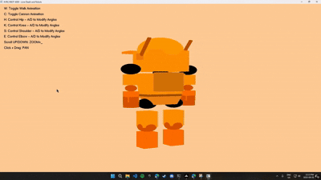

## Demo

# Stationary Cannon Shooter Game

A 3D shooter game written in **C++** using **OpenGL**. You control a stationary cannon to defend against hostile robots in a walled arena. The game uses prebuilt **KVRC 3D models** and features basic FPS mechanics, textured rendering, and procedural animation.

---

## Features

- Stationary cannon controlled with mouse and keyboard
- Projectile shooting with physics and collision
- Animated enemy robots with health and destruction
- Simple AI that moves robots toward the player
- Cannon disables when hit, with recovery animation
- Mesh importing of KVRC models (`mesh.obj`)
- Textured environment with ground, walls, and UI overlay

---

## Controls

| Key / Action        | Description                          |
|---------------------|--------------------------------------|
| `W`, `A`, `S`, `D`  | Move player/camera                   |
| Mouse Movement      | Aim the cannon (FPS style)           |
| `F` or `Space`      | Fire cannon                          |
| Left Click          | Fire cannon                          |
| `E`                 | Spawn enemy robots                   |
| `C`                 | Move faster                          |
| `Q` or `Esc`        | Quit the game                        |
